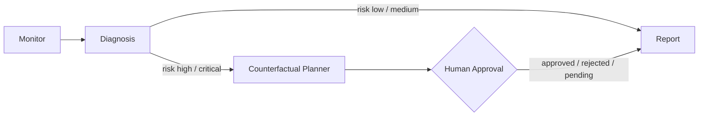

# Agentic PHM — Self-Healing Predictive Maintenance

> A multi-agent system that monitors equipment sensors, explains *why* failure risk is rising, proposes costed repair options, and authorises nothing until a human approves it.

**Author:** Amna Raheeba · Follow-on to my final-year project on explainable-AI predictive maintenance (LSTM + SHAP + counterfactual reasoning)

---

## 1. Overview

### 1.1 The problem
A single RUL (remaining useful life) model answers only one question: *how long until failure?* An operations team also needs: *which sensors are driving this, what can we do, what does each option buy us, and who approved it?*

### 1.2 The idea
Split those questions across specialised agents. Each step can then be tested, logged, and replaced independently — and the repair step can be gated by a human without touching the diagnosis code.

### 1.3 Data honesty
Everything runs on **synthetic** sensor data shaped like NASA C-MAPSS degradation (see `phm_agents/data/generator.py`). It is not NASA data, and no result here is a real-world benchmark.

## 2. How It Works

### 2.1 Agent pipeline



### 2.2 The agents

| Agent | Responsibility |
|---|---|
| **Monitor** | Validates the sensor window; computes baseline-vs-latest stats, slope, z-scores; flags anomalies |
| **Diagnosis** | Estimates RUL with a split-conformal prediction interval, assigns a risk level, ranks the sensors contributing most to health loss |
| **Counterfactual Planner** | High/critical risk only: costed repair options with estimated RUL gain, a no-downtime load-reduction option, and a failure-imagination roll-forward per option |
| **Report** | Auditable final report (JSON + Markdown) stating the approval disposition explicitly |

### 2.3 Key concepts

- **Human-in-the-loop as state** — `approval_status` (`pending / approved / rejected / not_required`) lives in the graph state. With no approver, a high-risk run ends as `AWAITING HUMAN APPROVAL` instead of silently proceeding.
- **Explainability** — contributing sensors are ranked by per-sensor health loss, in the spirit of the SHAP attributions in my FYP, computed directly from the estimator so report numbers always match the diagnosis.
- **Two graph runners, one state** — `graph.py` is a pure-Python runner (zero dependencies); `graph_langgraph.py` wires the same nodes into a real LangGraph `StateGraph`. Both share the `TypedDict` state in `state.py`.
- **Guardrails** — one retry on diagnosis, a `max_steps` limit, and a minimum window length.
- **Split-conformal RUL intervals** — the point estimate is wrapped in a calibrated prediction interval (`tools/conformal.py`, absolute-residual split conformal on held-out generated assets). If the interval's lower bound is inside the alert window while the point estimate is not, the report escalates: plan on the worst case, not the point. Coverage and the estimator's bias are measured openly in `results/conformal_coverage.csv`.
- **Failure imagination** — the counterfactual step simulates the next 120 cycles under no action and under each repair (repair resets its target sensor toward baseline), and reports the imagined failure cycle per scenario — the "failure imagination" idea from my FYP, as a pipeline step.

## 3. Quick Start

```bash
# Python 3.10+, no dependencies for the core pipeline
python -m phm_agents --auto-approve --output examples/demo_output.json   # faulty run
python -m phm_agents --healthy                                           # healthy run
python -m phm_agents --input phm_agents/data/sample_run.csv --approve    # prompt for approval

pip install pytest && pytest -q                                          # 17 tests
python -m phm_agents.evaluation.evaluate                                 # detection metrics
```

**Sample demo result** (synthetic run, `--auto-approve`): health index 0.23, RUL ≈ 21 cycles (90% prediction interval [0, 94]), risk **high** — top contributors temperature, vibration, pressure; cheapest counterfactual: cooling-path service ($450, 3h). Failure imagination: no action fails at +9 cycles, both repairs survive the 120-cycle horizon. Full output: [`examples/demo_output.json`](examples/demo_output.json).

## 4. Project Structure

```
phm_agents/
├── state.py / config.py        # shared TypedDict state · env-based config
├── graph.py                    # pure-Python graph runner (retry + step guard)
├── graph_langgraph.py          # optional LangGraph adapter, same nodes
├── agents/                     # monitor · diagnosis · counterfactual · failure imagination · report
├── tools/                      # sensor statistics · heuristic RUL estimator · conformal intervals
├── data/                       # seeded synthetic generator + sample_run.csv
└── evaluation/                 # precision / recall on labelled synthetic runs
notebooks/ · results/           # numbered experiment scripts · coverage CSV, interval plot
docs/experiment_log.md          # what was tried, what happened, what I decided
tests/                          # generator · RUL model · conformal · failure imagination · graph end-to-end
```

## 5. Design Decisions

| Decision | Why |
|---|---|
| Heuristic RUL baseline, deliberately | Inspectable and wrong in known ways — a fair baseline to beat. Claiming LSTM metrics for code that trains no LSTM would be worse. |
| Approval gate before any repair action | In real maintenance, an unauthorised action is worse than a late one. |
| Pure-Python core, LangGraph optional | The logic stays readable and testable anywhere; the framework is an adapter, not a dependency. |

## 6. Evaluation

On 24 labelled synthetic runs (12 faulty / 12 healthy): **precision 1.00, recall 1.00**.

> Read this correctly: generator and detector share the same degradation shape, so this mainly proves the pipeline is wired end-to-end. It says nothing about performance on real equipment.

## 7. Limitations & Roadmap

**Limitations:** synthetic, uncalibrated data · linear RUL heuristic whose conformal intervals are honest but wide (half-width ≈ 73 cycles at 90% — the estimator runs optimistic, see `docs/experiment_log.md`) · counterfactual gains and imagined failure cycles are internal-consistency estimates, costs are illustrative · single asset, single window.

**Roadmap:** swap in the LSTM + SHAP model from my FYP behind the same estimator interface and evaluate on real C-MAPSS FD001 · a slope-aware loss rate to cut the estimator bias the conformal experiment exposed · streaming monitor with persistent run history. ~~Uncertainty-aware risk before the approval gate~~ — done in v0.2.0 (split-conformal intervals + escalation).

## License

MIT © 2026 Amna Raheeba — see [LICENSE](LICENSE).
